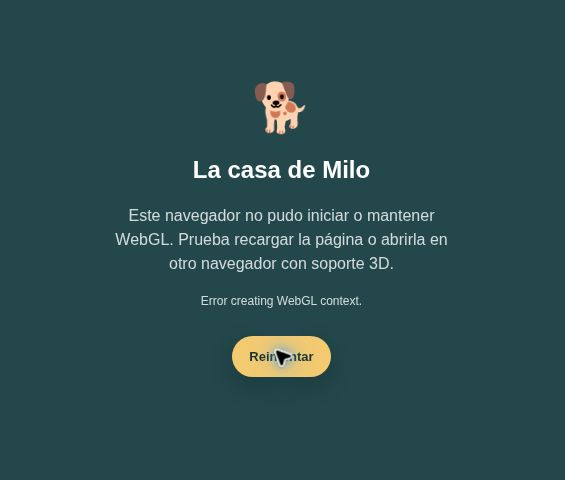

# Milo: revisión de estabilidad del 14 de noviembre de 2026

## Resultado y límites

Se reprodujo el bloqueo de carga en la versión pública basada en `9c0a17f10e60ad2f4cdcabb64249e1c972eedeb2` y se corrigieron los defectos de arranque y navegación descritos abajo. Las doce pruebas automatizadas de lógica pasaron. **La escena 3D no se ha validado visualmente ni se ha certificado su rendimiento en Safari/iPhone.**

El navegador Chrome disponible para esta revisión informa `GL_VENDOR = Disabled`, `GL_RENDERER = Disabled` y `Error creating WebGL context`. Después de corregir la sintaxis, este límite del entorno impide renderizar la casa, los muebles y el perro. No se atribuye ese bloqueo al dispositivo del usuario.

## Fallos reproducidos y correcciones

| Problema | Evidencia y corrección |
| --- | --- |
| Carga detenida sin diagnóstico | El navegador público y `node --check` reportaron `Identifier 'frame' has already been declared`. La función decorativa y el contador de animación compartían nombre; se renombró la función. |
| Segundo bloqueo de arranque | El motor de pruebas reprodujo `Cannot access 'carrying' before initialization`. Se eliminó la sincronización prematura de juguetes; ocurre al comenzar la animación, con las dependencias inicializadas. |
| Puerta y colisión incompatibles | La colisión antigua ocupaba la apertura del comedor. Se alineó con las paredes y se amplió la apertura para permitir el acceso por el costado de las sillas. El destino del comedor ahora queda en una zona libre. |
| Destinos dentro de muebles | Se normalizan a puntos libres. La búsqueda ya no abandona arbitrariamente después de 700 nodos. |
| Atasco en esquinas | Una simulación de cinco minutos quedó atascada cerca de la salida al jardín. Se dejaron de saltar los últimos 13 cm de cada tramo; ahora Milo completa cada punto y valida los segmentos. |
| Tamaño visual y colisión diferentes | El modelo original era mucho más grande que su círculo de colisión. Su escala se ajustó a 0,25 y el radio a 0,40; se comprobó la geometría animada contra ese radio. Este cambio de escala requiere revisión estética en un navegador con WebGL. |
| Decoración sin colisión | Se incorporaron las bases de muebles y decoración sólida al mapa, además de las huellas explícitas de mesas y sillas. Suelos, alfombras planas y juguetes movibles quedan transitables. |
| Juguete se teletransportaba al elegirlo | Ahora se adjunta a la boca solo después de llegar al punto de recogida. La entrega se guarda en un punto libre. |
| Guardado de ubicación incorrecta | Se guardaba el destino de la actividad, no la ubicación visible. Ahora se conserva la posición real, incluso al ocultar o cerrar la página. |
| Error de carga difícil de recuperar | Un controlador separado del módulo muestra un diagnóstico y un botón de reintento ante errores o espera excesiva. Una pérdida de contexto guarda el progreso y detiene el bucle; la restauración inicia un solo bucle. |

Las creaciones existentes no vuelven a dibujarse por duplicado al completar la siguiente actividad. Se reutiliza el vector de la boca, evitando una asignación por juguete transportado y fotograma.

## Pruebas ejecutadas

`npm ci --ignore-scripts --no-audit --no-fund` y `npm test` reproducen las comprobaciones. Se utiliza Three.js 0.161.0 real para escena, geometría y matemáticas; DOM, audio, reloj y renderer WebGL se sustituyen en el motor de pruebas. **Pasar estas pruebas no equivale a ejecutar WebGL.**

| Prueba | Resultado |
| --- | --- |
| Sintaxis de ambos scripts HTML | Pasó |
| Construcción de escena y primer fotograma con renderer simulado | Pasó |
| 100 rutas entre los diez destinos, incluidos todos sus segmentos | Pasó |
| Movimiento a los diez destinos sin colisiones registradas ni atascos | Pasó |
| Geometría animada del cuerpo dentro del círculo de colisión | Pasó |
| Diez minutos de tiempo simulado, semilla 123456 | Pasó |
| Guardado al salir y restauración de coordenadas | Pasó |
| Recogida, transporte y entrega persistente de un juguete | Pasó |
| Funciones de giro, zoom, paneo, cancelación y seguimiento | Pasó; eventos simulados |
| Apertura y cierre de diario y personalidad | Pasó; DOM simulado |
| Pérdida y restauración de contexto, incluida restauración inmediata | Pasó; eventos simulados |
| Excepción durante un fotograma detiene el bucle y muestra error | Pasó; fallo inyectado |
| Fallo del primer render conserva el aviso y el registro de visita previo | Pasó; fallo inyectado |
| Reintentar desde el aviso WebGL | Ejecutado en Chrome; recarga y vuelve al aviso debido al límite del entorno |

El flujo de publicación ejecuta estas pruebas antes de desplegar y empaqueta únicamente `index.html`.

## Rendimiento y calidad pendientes

En la escena inicial de escritorio se contaron 685 mallas, 464 mallas que proyectan sombras, 120.735 vértices contando instancias y seis luces. Son recuentos de escena, **no mediciones de draw calls ni FPS**. La cantidad de objetos y sombras merece perfilado en un iPhone antes de añadir más detalle.

No se pudieron evaluar materiales, iluminación final, sombras, recortes de cámara, legibilidad del perro después del ajuste de escala, suavidad de gestos táctiles, audio audible, memoria GPU ni estabilidad sostenida en Safari. La dependencia CDN sigue requiriendo conexión. La ausencia de errores de shaders tampoco se da por comprobada: el navegador de pruebas no pudo crear el contexto.

Para cerrar la validación visual se requiere una sesión con WebGL: abrir la casa, recorrer todos los cuartos, acercar/alejar y girar la cámara, observar la recogida de juguetes, comprobar que el cuerpo no se solapa con muebles, activar el sonido, volver del segundo plano y recargar para verificar la continuidad. Estas comprobaciones quedan pendientes.
